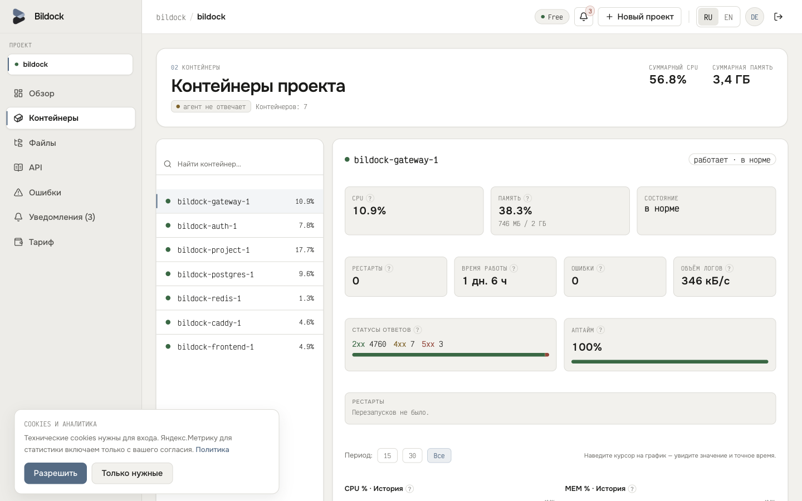
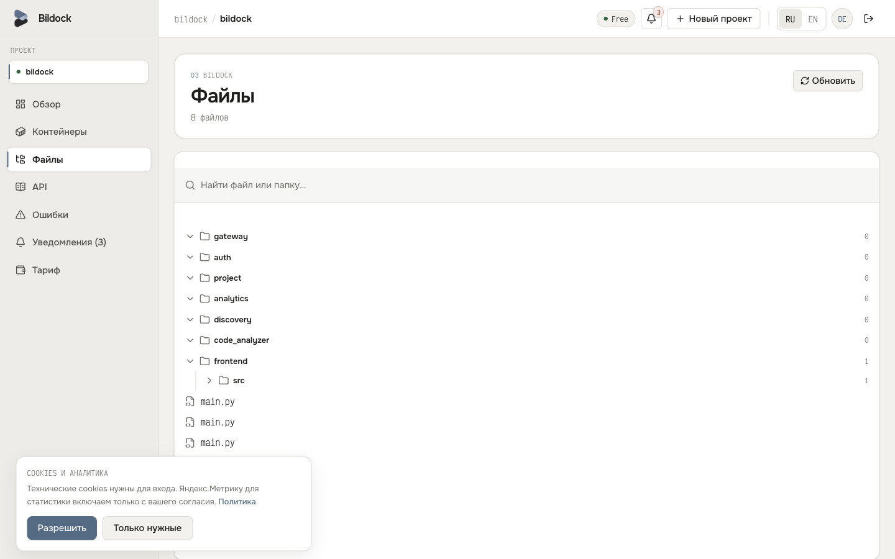
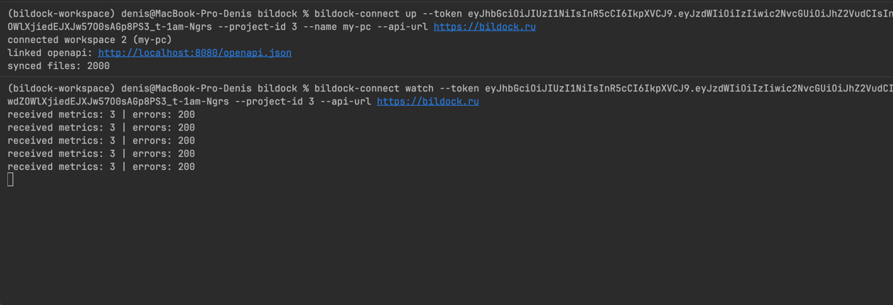
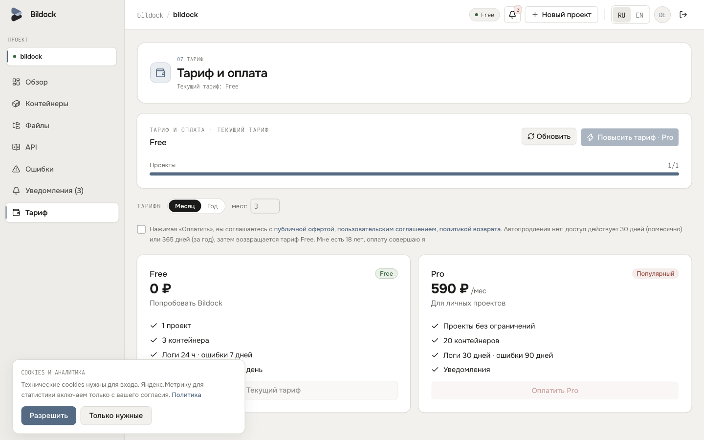
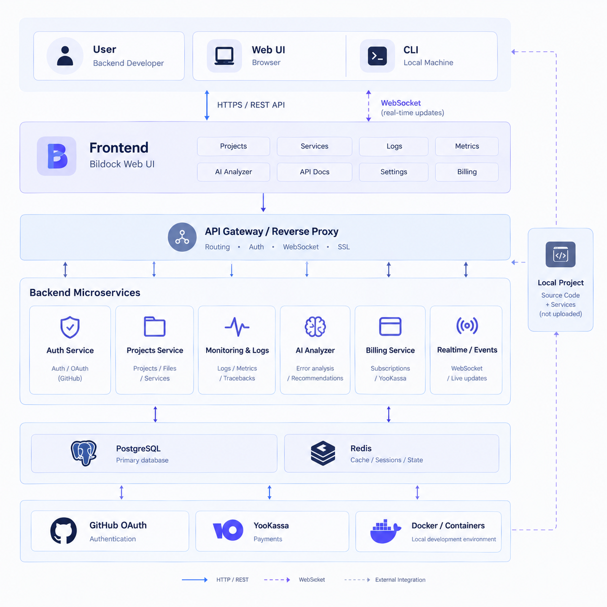
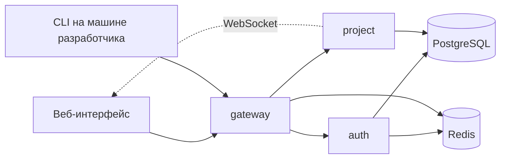

# Bildock

### Подключи локальный проект и смотри его метрики в реальном времени

SaaS-сервис для backend-разработчиков: CLI, веб-интерфейс, файловое дерево и состояние сервисов проекта в одном окне

 

 

<table>
  <tr>
    <td align="center"><h2>48</h2>эндпоинтов</td>
    <td align="center"><h2>171</h2>тест</td>
    <td align="center"><h2>~1500</h2>RPS на gateway</td>
    <td align="center"><h2>~8 мс</h2>p95</td>
  </tr>
</table>

Замеры производительности локальные

[Скриншоты](#-как-это-выглядит) · [Возможности](#-возможности) · [Архитектура](#-архитектура) · [Решения](#-технические-решения) · [Контакты](#-контакты)

 

> [!NOTE]
> Исходный код закрыт (коммерческий проект). В репозитории только документация и скриншоты. Код покажу на созвоне или дам временный доступ к приватному репозиторию.

## 🧭 Что это

Bildock позволяет создать проект, подключить локальное рабочее окружение через CLI и управлять проектом через веб-интерфейс.

Для каждого проекта отдельно собираются и показываются метрики и состояние его сервисов: нагрузка контейнеров, CPU/RAM, состояние процессов. Это данные именно запущенного проекта, а не всего сервера или компьютера.

## 📸 Как это выглядит

<table>
  <tr>
    <td align="center"><b>Панель метрик</b>  </td>
    <td align="center"><b>Файловое дерево проекта</b>  </td>
  </tr>
  <tr>
    <td align="center"><b>Подключение через CLI</b>  </td>
    <td align="center"><b>Подписки и оплата</b>  </td>
  </tr>
</table>

## ✨ Возможности

<table>
  <tr>
    <td valign="top" width="50%">
      <b>💻 Для разработчика</b>
      <ul>
        <li>Подключение локального проекта через CLI</li>
        <li>Файловое дерево проекта в вебе</li>
        <li>Метрики: контейнеры, CPU/RAM, процессы</li>
        <li>Обновления в реальном времени (WebSocket)</li>
      </ul>
    </td>
    <td valign="top" width="50%">
      <b>🔐 Безопасность</b>
      <ul>
        <li>Вход через email, GitHub и Яндекс (OAuth2)</li>
        <li>JWT с ротацией refresh-токенов в Redis</li>
        <li>Rate limiting (slowapi + Redis)</li>
        <li>HTTPS и gateway перед сервисами</li>
      </ul>
    </td>
  </tr>
  <tr>
    <td valign="top">
      <b>💳 Платежи</b>
      <ul>
        <li>Подписки с оплатой через ЮKassa</li>
        <li>Обработка webhook</li>
        <li>Идемпотентность платёжных операций</li>
      </ul>
    </td>
    <td valign="top">
      <b>⚙️ Инфраструктура</b>
      <ul>
        <li>Деплой в Yandex Cloud</li>
        <li>Docker Compose, логирование</li>
        <li>CI на GitHub Actions за 60-75 секунд</li>
        <li>10 миграций Alembic</li>
      </ul>
    </td>
  </tr>
</table>

## 🏗 Архитектура

  

 

Микросервисный backend на FastAPI (asyncio): три сервиса (auth, gateway, project), 8 таблиц PostgreSQL. Развёрнут в Yandex Cloud: Docker Compose, HTTPS, gateway, логирование.

Схема в виде текста (Mermaid)

## ✅ Качество

| Тесты | Покрытие | CI | Производительность gateway |
|:---:|:---:|:---:|:---:|
| **171** на pytest | **81-93%** по сервисам | **60-75 сек** | **~1500 RPS**, p95 **~8 мс** |

 

## 🛠 Технические решения

**Авторизация.** JWT-авторизация с ротацией refresh-токенов: токены хранятся в Redis, при обновлении выдаётся новая пара. Вход через email, GitHub и Яндекс.

**Платежи.** Подписки оплачиваются через ЮKassa. Webhook обрабатывается идемпотентно, чтобы повторные уведомления не приводили к двойным операциям.

**Защита API.** Rate limiting через slowapi с хранением счётчиков в Redis.

**Реальное время.** Метрики и состояние проекта приходят в интерфейс по WebSocket, без перезагрузки страницы.

## 🚧 Дорожная карта

- [x] MVP запущен: https://bildock.ru
- [x] Авторизация, подписки, CLI, файловое дерево, метрики
- [ ] Модуль анализа логов и ошибок на основе LLM (в разработке)
- [ ] Новые функции для работы с проектами

## 📬 Контакты

**Мищенко Денис**, Python Backend-разработчик (FastAPI)

